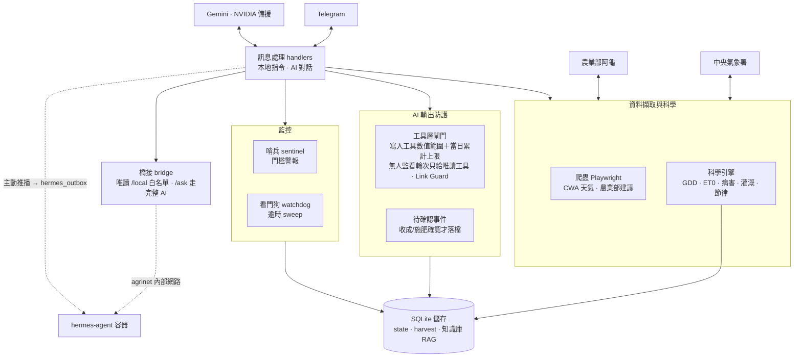

# agribot 架構

自主農務監控 Telegram bot：爬中央氣象署與農業部資料，跑科學引擎（GDD/ET0/病害/灌溉/節律），
由 Gemini 做 AI 對話與閉環控制，所有會改狀態的動作都經防護欄驗證。

## 設計重點

- **AI 只能經工具呼叫改狀態**：調門檻、切作物只有 `agent/tools.py` 的工具一條路，工具內有數值範圍
  （`0 < dry < wet < 60`）、單次與當日累計調幅上限。舊版「回覆裡夾 `[SET_THRESHOLD]` 文字標記」的解析器
  已於 2026-10-31 拆掉：出現只清除並記 warning，絕不套用。
- **無人監看的輪次只有唯讀工具**：定時推播、哨兵、Hermes 橋接 `/ask` 都用 `READONLY_TOOLS`（查詢類），
  prompt 裡夾著爬來的外部資料也改不了任何狀態；橋接另用獨立 session，不共用主人的對話記憶。
  AI 回覆中的連結一律移除（`agent/guard.py`）。
- **破壞性事件要確認**：收成/施肥會寫進長期記錄，先登記為「待確認」，使用者確認或喊停視窗逾時才落檔
  （`agent/pending.py`，threading.Lock 認領 + contextvars 隔離併發）。
- **橋接最小開放**：`bridge/server.py` 只監聽內部 Docker 網路、要求 HMAC 共用密鑰、body 上限、
  socket timeout、`/local` 唯讀白名單伺服器端強制；啟動失敗只停用 bridge、不拖垮核心 bot。
- **防注入**：爬回的網頁文字與農業建議當不可信資料，防間接 prompt injection。

## 部署

走 Synology Drive 自動同步 → NAS `/volume2/docker/agriweather-bot/` → Container Manager。
commit 用 **GitHub Desktop**（勿用 CLI）。改 `.py` 要**重建容器**才生效
（`bridge/` 等是 Dockerfile `COPY` 進 image，非 bind mount）。NAS 容器名為 `agriweather-bot`。
